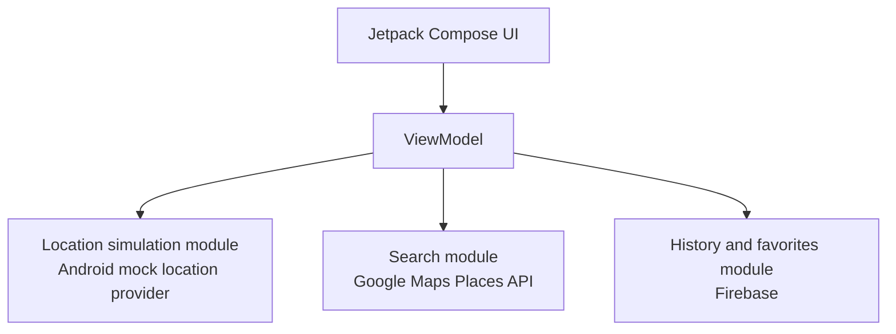

# Mockify: Mock Location App for Testing Location-Based Features

Final Year Project, BS Software Engineering, The Islamia University of Bahawalpur (2025).
Built by **Haris Hameed Qazi** and **Muhammad Kamran**, supervised by **Ma'am Tayyaba Rashid**.

## The problem

Many apps change what they show based on where you are: prices, delivery areas, language, content. Testing those features is hard. A tester in Lahore can't easily check how an app behaves in Birmingham, Riyadh or Toronto, and the tools that fake GPS are often clumsy or unreliable.

As a QA tester, I wanted a simple way to set any location on an Android device and keep it there while testing other apps.

## What it does

- **Search any place.** Type part of a name and pick from suggestions (Google Maps Places).
- **Start and stop mocking.** One button sets the device's GPS to the chosen place, through Android's mock location provider. It stays set while you use other apps, until you stop it.
- **See exact coordinates.** Latitude, longitude and address are shown for every location, so testers can record exactly what they tested.
- **Favorite locations.** Save test locations (for example, one per country you support) and switch between them quickly.

| Home | Mocking a location | Favorite locations |
|---|---|---|
|  |  |  |

## Architecture



The app follows the MVVM pattern: Compose screens, ViewModels for state and logic, and separate modules for mocking, place search and saved locations.

## Build and run

1. Open the project in Android Studio (min SDK 28, target SDK 35).
2. Create a Firebase project, enable Email/Password sign in and Realtime Database, and put your `google-services.json` in `app/`.
3. Add a Google Maps key to `local.properties`: `MAPS_API_KEY=your_key`
4. Run the app on a device.

## How to use it

1. Turn on **Developer options** on the Android device.
2. In Developer options, open **Select mock location app** and choose Mockify.
3. Search for a place, then tap **Start mocking**.
4. Open the app you're testing. Tap **Stop mocking** when you're done.

Please use Mockify only to test apps on your own devices.

## Code structure

```
app/src/main/java/com/mockify/app/
  service/        LocationMocker, MockLocationService (foreground service that keeps the mock location set)
  ui/screens/     MapScreen, SignInScreen and the MapViewModel
  ui/components/  search, favorites list, mock location setup dialog
  auth/           Firebase sign in
  storage/        saved favorites and settings
```

## Tech stack

Kotlin · Jetpack Compose · MVVM · Google Maps API · Android Mock Location Provider · Firebase

## Documents

- [Software Requirements Specification](docs/Software-Requirements-Specification.pdf)
- [Software Design Document](docs/Software-Design-Document.pdf)
