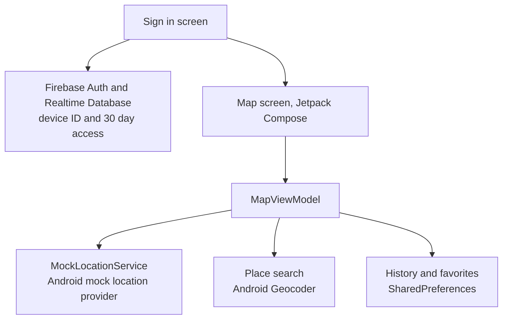

# Mockify: Mock Location App for Testing Location-Based Features

Final Year Project, BS Software Engineering, The Islamia University of Bahawalpur (2025).
By **Haris Hameed Qazi** and **Muhammad Kamran**, supervised by **Ma'am Tayyaba Rashid**.

## Credit

Mockify is built on **[MockGps by lilstiffy](https://github.com/lilstiffy/MockGps)**, an open source Android app licensed under GPL 3.0. The location mocking engine, the map screen, place search, favorites and the app theme come from that project. Mockify is released under the same license (see [LICENSE](LICENSE)).

## What we added

- **Account sign in** with Firebase Authentication (email and password), with input validation and a "remember me" option.
- **Device based licensing.** On first login the account is tied to the phone's device ID and given a 30 day access period, stored in Firebase Realtime Database. Logins from another device are refused, and when the period ends the user is signed out.
- **Current location button** that moves the map to where the phone really is, with checks for location permission and for GPS being switched on.
- **Setup guide dialog** that walks a new user through choosing Mockify as the mock location app in Developer options.
- **Interface changes:** splash screen, new icons, text that no longer overflows, a message when the search box is empty, and an updated build (target SDK 35, newer libraries).
- **Project documents:** a Software Requirements Specification and a Software Design Document (in `docs/`).

## The problem

Many apps change what they show based on where you are: prices, delivery areas, language, content. Testing those features is hard. A tester in Lahore can't easily check how an app behaves in Birmingham, Riyadh or Toronto.

As a QA tester, I wanted a simple way to set any location on an Android device and keep it there while testing other apps, with access controlled per tester.

## What it does

- **Search any place** and see it on the map.
- **Start and stop mocking.** One button sets the device's GPS to the chosen place through Android's mock location provider. It stays set while you use other apps, until you stop it.
- **See exact coordinates.** Latitude, longitude and address are shown for every location, so testers can record exactly what they tested.
- **Favorite locations.** Save test locations (for example, one per country you support) and switch between them quickly.

| Home | Mocking a location | Favorite locations |
|---|---|---|
|  |  |  |

## Architecture



## Build and run

1. Open the project in Android Studio (min SDK 28, target SDK 35).
2. Create a Firebase project, enable Email/Password sign in and Realtime Database, and put your `google-services.json` in `app/`.
3. Add a Google Maps key to `local.properties`: `MAPS_API_KEY=your_key`
4. Run the app on a device.

## How to use it

1. Turn on **Developer options** on the Android device.
2. In Developer options, open **Select mock location app** and choose Mockify.
3. Sign in, search for a place, then tap **Start mocking**.
4. Open the app you're testing. Tap **Stop mocking** when you're done.

Please use Mockify only to test apps on your own devices.

## Code structure

```
app/src/main/java/com/mockify/app/
  SignInActivity, auth/   Firebase sign in and device licensing (added)
  service/                LocationMocker, MockLocationService (from MockGps)
  ui/screens/             MapScreen (extended), SignInScreen (added), MapViewModel
  ui/components/          search, favorites, footer (from MockGps), MockLocationDialog (added)
  storage/                saved history, favorites and login state
```

## Tech stack

Kotlin · Jetpack Compose · MVVM · Google Maps · Android Mock Location Provider · Firebase Auth · Firebase Realtime Database

## License

GPL 3.0, the same as the original MockGps project. See [LICENSE](LICENSE).

## Documents

- [Software Requirements Specification](docs/Software-Requirements-Specification.pdf)
- [Software Design Document](docs/Software-Design-Document.pdf)
